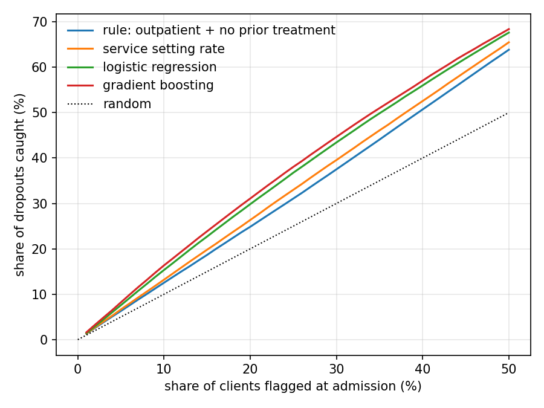

# who drops out of substance use treatment in California

## what i wanted to know

About 40% of publicly funded treatment episodes in California end with the client dropping out. At admission, can you rank clients by dropout risk well enough to decide who gets extra check-ins, and does a model beat the rule a program already uses, "outpatient clients with no prior treatment drop out most"? This is for early outreach, not for turning anyone away. Published TEDS-D models mostly use random splits and often include length of stay, which is not known at admission, so the design here is strictly admission-only features tested on later years, scored against the rule a program would use.

## data

SAMHSA TEDS-D, the national discharge file for publicly funded treatment, discharge years 2020 to 2023, California only: 432,128 episodes. California fills in the admission fields almost completely but skips insurance, marital status, income and diagnosis. The 2021 file ships with text labels instead of codes and leaves two fields mostly blank, so the notebook maps the labels back and drops those two. Nothing row level is in the repo.

## what i did

Target is dropped out or terminated by the facility (38% to 48% depending on year). Features are admission only: demographics, employment, living arrangement, referral source, prior episodes, service setting, medication-assisted treatment, mental health flag, days waited, primary substance with route, frequency and age at first use. An assert keeps discharge fields out.

Split by discharge year: train 2020 to 2021 and test 2022, then train through 2022 and test 2023. Methods: the program rule, the service setting's past dropout rate, logistic regression, gradient boosting (HistGradientBoostingClassifier inside isotonic CalibratedClassifierCV).

## results

Averaged over the two test years:

| method | PR-AUC | ROC-AUC | dropouts caught in top 10% | top 20% |
|---|---|---|---|---|
| rule: outpatient + no prior treatment | 0.484 | 0.641 | 12.6% | 24.9% |
| service setting rate | 0.500 | 0.658 | 13.2% | 26.2% |
| logistic regression | 0.540 | 0.687 | 15.3% | 29.8% |
| gradient boosting | 0.564 | 0.700 | 16.3% | 31.1% |

Boosting catches 6.2 more points of dropouts in its top 20% than the rule, 95% bootstrap CI 5.9 to 6.5. Precision in that top 20% is 64% vs 49%.



The signal is modest. AUC 0.70 says who is more likely to drop out, not who will. Within one service setting the model's AUC is 0.53 to 0.64, a little more than the setting knows. Both models predict a few points high because dropout fell every year. Dropping the 30% of episodes that end in a transfer, which could hide either outcome, raises boosting's AUC to 0.76 and the gain to 7.1 points, so the result does not hinge on transfers.

Subgroups: the model flags 11% of homeless clients and 27% in independent living, since homeless clients mostly enter residential care where dropout is rarer. Precision among flagged clients is similar across race (56% to 66%), but the share flagged runs from 13% of Black clients to 23% of White clients.

## caveats

- Publicly funded treatment only, and episodes, not people.
- Dropout is an administrative code, not a clinical outcome.
- No severity, housing history or prior outcomes at admission, which is probably the ceiling.
- 2020 and 2021 are pandemic years.

## how to run

```
pip install -r requirements.txt
jupyter notebook treatment_dropout.ipynb
```

Run top to bottom, about 20 minutes. Downloads skip files already in data/.
